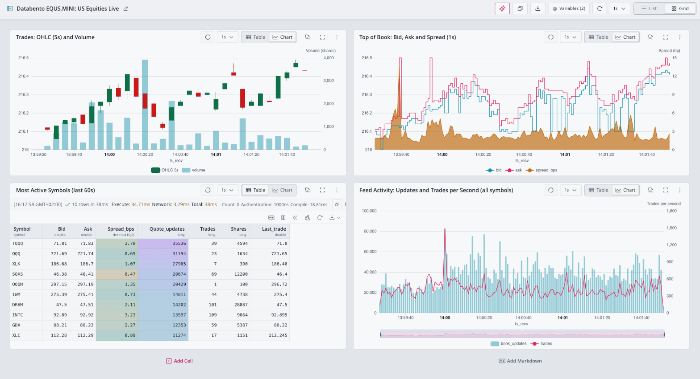

# Databento order book ingestion into QuestDB

Companion code for the QuestDB blog post on streaming Databento market data
into QuestDB.

The example streams top-of-book quotes (`mbp-1`) and trades for every symbol
in Databento's `EQUS.MINI` dataset into two QuestDB tables, then queries them
with QuestDB SQL. It runs for a few minutes and stops, so it never stores
more than a small sample.

## What's inside

| File | Purpose |
| --- | --- |
| `connector.toml` | Connector configuration: dataset, subscriptions, tables, recovery |
| `ingest_for.py` | Runs the connector for a fixed number of minutes, then stops it cleanly |
| `sql/queries.sql` | Queries over the ingested data |
| `run_sql.py` | Runs the named statements in a `.sql` file and prints the results |
| `questdb-databento-dashboard.json` | QuestDB Web Console dashboard over the two tables |
| `docker-compose.yml` | QuestDB 10.0.1 |
| `.env.example` | Credentials and settings template |

The Python scripts use only the standard library.

## Requirements

- QuestDB 10.0.1 or later. The connector writes with the QuestDB Wire
  Protocol (QWP) over WebSocket on port `9000`.
- A Databento API key with Live access to `EQUS.MINI`.
- The `databento-questdb` connector binary.
- Python 3.9 or later.

## Quick start

```bash
# 1. Start QuestDB
docker compose up -d

# 2. Configure credentials
cp .env.example .env
# edit .env: set DATABENTO_API_KEY, and DATABENTO_QUESTDB_BIN if the
# connector binary is not on PATH

# 3. Stream live data for three minutes
python3 ingest_for.py --minutes 3

# 4. Query what arrived
python3 run_sql.py sql/queries.sql
```

Open the QuestDB Web Console at http://localhost:9000 to explore the
`equs_orderbook` and `equs_trades` tables.

Run a single query by name:

```bash
python3 run_sql.py sql/queries.sql latest_quotes
```

## Dashboard

`questdb-databento-dashboard.json` is a native QuestDB Web Console dashboard, built as a
notebook. It needs QuestDB 10.0 or later, or QuestDB Enterprise 4.0 or later. To install, open
the **⋮** menu at the right end of the Web Console tab bar, choose **Import tabs**, and import the
file. It opens as a new notebook tab, **Databento EQUS.MINI: US Equities Live**, already in the
grid layout.

| Cell | Shows |
| --- | --- |
| Trades: OHLC (5s) and Volume | 5-second candles from trades, with traded shares on the right axis |
| Top of Book: Bid, Ask and Spread (1s) | Best bid and ask, with the spread in basis points on the right axis |
| Most Active Symbols (last 60s) | Top 10 symbols by quote updates, with latest quote, spread, trades, and last price |
| Feed Activity: Updates and Trades per Second | Book updates and trades per second across all symbols |

It uses notebook variables: `@symbol` (`'NVDA'` by default) selects the symbol for the two
charts at the top, and `@asof` (`now()`) is the end of the window. Each cell shows the latest data
up to `@asof`, ten minutes for the charts and sixty seconds for the table, so it still renders
after the connector stops. Set `@asof` to a past instant to look at an earlier window. The
dashboard refreshes every second.



## How it works

The connector subscribes to two Databento schemas and writes each to its own
table. Tables are created on first write, partitioned by day, with
nanosecond `ts_event` and `ts_recv` columns and `ts_recv` as the designated
timestamp.

| Table | Schema | Contents |
| --- | --- | --- |
| `equs_orderbook` | `mbp-1` | Every change to the best bid or offer, plus trade events |
| `equs_trades` | `trades` | Trades only |

Book levels are stored as `DOUBLE[][]` arrays of shape `[2, N]`, best level
first: row 1 holds prices and row 2 sizes. `bids[1][1]` is the best bid price
and `bids[2][1]` its size. An empty side of the book is `NULL`.

`ingest_for.py` sends `SIGINT` when the time is up. The connector then drains
in-flight rows, waits for QuestDB to acknowledge them, and saves a checkpoint
under `state/`.

## Recovery after downtime

Run `ingest_for.py` again and the connector resumes from the checkpoint. It
asks Databento to replay from shortly before the last acknowledged record,
using intraday replay, so rows published while it was stopped arrive first
and the timeline has no gap:

```bash
python3 ingest_for.py --minutes 1
python3 run_sql.py sql/queries.sql arrival_timeline duplicate_check
```

Delivery is at least once. The replay overlaps the previous run by a few
seconds, which writes those rows twice. `replay_dedup = true` in
`connector.toml` filters the replayed records out. It relies on `ts_event`
never going backwards per instrument, which holds for `EQUS.MINI`.

Intraday replay generally covers the last 24 hours. After a longer outage,
backfill the gap with the connector's Historical mode, which Databento bills
separately.

## QuestDB downtime

If QuestDB stops while the connector is running, for example during an
upgrade, the connector keeps receiving from Databento and holds unacknowledged
rows in memory. When QuestDB is back it resends them, and each row keeps its
original Databento `ts_recv` timestamp. The buffers are bounded: when they
fill, the connector pauses reading from Databento rather than dropping data.
Start QuestDB before the connector; by default the connector's first
connection fails if QuestDB is down.

## Notes

- **Market hours matter.** Outside US regular trading hours few symbols
  trade, so some queries return few rows.
- **Keep runs short.** `ALL_SYMBOLS` on `mbp-1` is a heavy stream during
  regular hours. The connector stops after `--minutes`.
- **Start fresh.** To start over, drop both tables and delete `state/`.
  Changing the subscriptions or tables also requires a new state directory.
